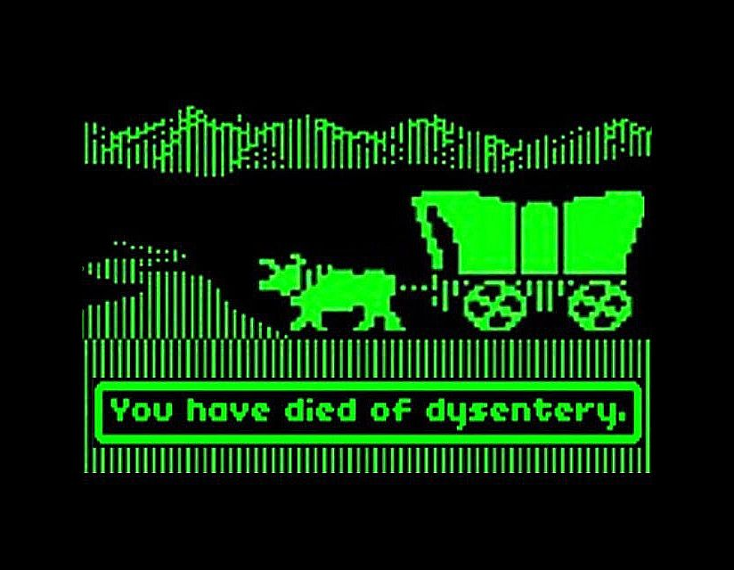
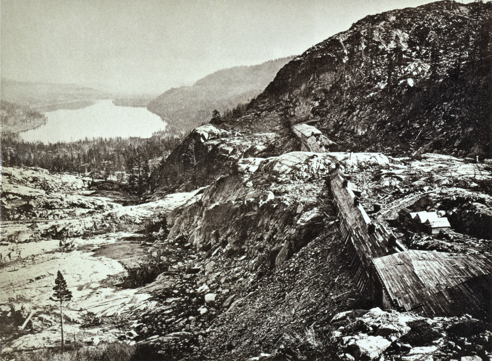
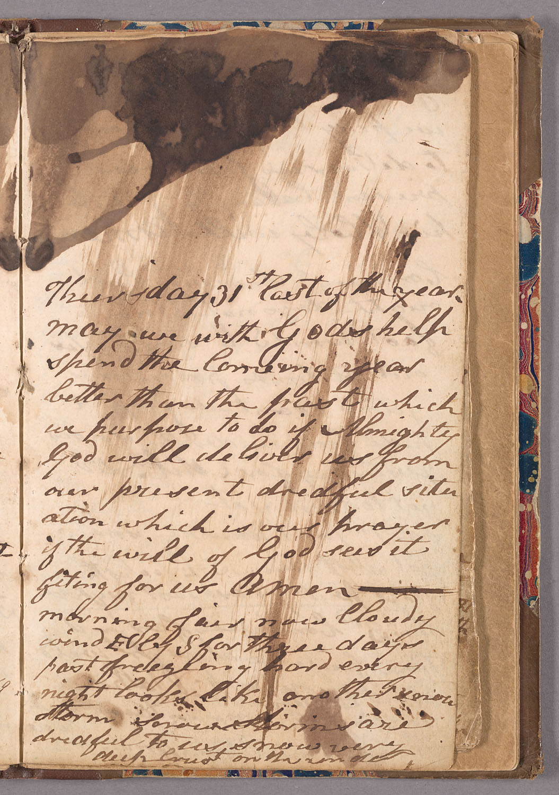

Everybody my age has a body count from the computer lab.

The weapon was The Oregon Trail. It lived on the school computers for a generation, and the ritual never changed. You named your wagon party after your friends, your siblings, kids you had crushes on, kids you could not stand. You hunted. You forded rivers you had no business fording. You bought too many grandfather clocks and not enough food, or the other way around. And sooner or later, usually sooner, the screen gave you the sentence.

You have died of dysentery.

It was the funniest sentence in elementary school. It is still funny. The game even let you carve tombstones for the dead, and we wrote jokes on them, because the game had taught us the correct emotional register for trail death, and the register was a punchline. When you died, the run ended. You started over, or the bell rang. Death was a full stop, and a full stop is easy to laugh at. Nothing comes after it.

<!-- Image provenance: Copyrighted game imagery; Apple II edition (1985), Minnesota Educational Computing Consortium (MECC). Used for editorial criticism/commentary. Not public domain. -->
<figure>

<figcaption>The Oregon Trail (MECC, 1985). Death as a full stop. Screenshot from The Oregon Trail (MECC, 1985), Apple II.</figcaption>
</figure>

The sentence is flat because the game is a system, and a system only has the one register. Dysentery arrives in the same tone as a broken axle or a stolen ox, because to the machine those are the same kind of thing: an event, drawn from a list, applied to your numbers. What I did not know until recently is that the flatness was researched. When Don Rawitsch, one of the game's creators, rebuilt it at MECC in the mid-1970s, he [calibrated its probabilities from real emigrant diaries](https://www.smithsonianmag.com/innovation/how-you-wound-playing-em-oregon-trailem-computer-class-180959851/), the daily journals of people who actually walked west, reading them for the events themselves and for how often the river or the sickness ought to take someone. The gag has a bibliography. The game read the diaries and turned them into dice.

Patrick Breen kept one of those diaries. He was not even going to Oregon. His party took the cutoff toward California, the Hastings Cutoff, and got snowed in with the Donner Party in November 1846.

<!-- Image provenance: Public domain. Andrew J. Russell, Summit of Sierra Nevada — snow sheds in foreground, Donner Lake in the distance, Central Pacific R.R.; supplied via Wikimedia Commons. Sun Pictures of Rocky Mountain Scenery (1869). -->
<figure>

<figcaption>Donner Lake and the pass, photographed a generation later. The Breens wintered at its eastern end. Andrew J. Russell, 1868. Library of Congress. <a href="https://commons.wikimedia.org/wiki/File:Donner_Lake_and_snow_sheds2.jpg">Source</a></figcaption>
</figure>

Breen wrote almost every day from then until rescue, in a shanty, on short rations, in a hand that never once changes its mind about what a sentence is for. Death, disease, weather, hunger, and the habit of writing them down were common to every road west. The catastrophe was not common. Breen recorded his in the same hand as an ordinary journey, which is rather the point. What the game did to the diary form, and what the diary form actually was, is the whole distance between the punchline and the record.

Here is December 21, 1846, in full working order. Milt Elliot has just come back from the Donner camp with news:

"Jake Donno Sam Shoemaker Rinehart, & Smith are dead the rest of them in a low situation"

And then, same entry, same breath: "Snowed all night with a strong S-W wind." Four men are dead. The wind is from the southwest. Breen does not rank these facts. He cannot afford to. Ranking is a luxury of people who get to stop, and the entry is a list of what the day contained, and the day contained both.

By February the syntax has not changed, only the names have gotten closer to home. The entry for February 5 is mostly about snow, about Peggy Breen's fear that they will all perish, about how much meat is left and how many hides. It ends: "Eddys child died last night." February 8 opens with the weather, because so many entries open with the weather: "Fine clear morning wind S. W. froze hard last." Then: "Spitzer died last night about 3 o clock to we will bury him in the snow Mrs Eddy died on the night of the 7th." Two deaths and a burial arrangement in one unpunctuated run, and the burial is logistics, because the ground is frozen and the snow is what there is. None of this is coldness. Breen's feelings are all through the diary. They just arrive at the same size as everything else. In December, in the same entry where Charley turns back, his whole morale fits in one unpunctuated run: "tough times, but not discouraged our hopes are in God. Amen." The hope gets one clause. The despair, when it comes, will get about the same.

Which brings me to the pockets.

<!-- Image provenance: Public domain. Diary of Patrick Breen, page 13; December 31, 1846 and damaged December 30 material. BANC MSS C-E 176, UC Berkeley Digital Collections record 154921. Hero is a crop of this same supplied page. -->
<figure>

<figcaption>Breen's page for the turn of the year. The December 31 entry is the legible one; December 30 sits above it, in the water damage. Diary of Patrick Breen, Banc MSS C-E 176, The Bancroft Library, University of California, Berkeley. <a href="https://digicoll.lib.berkeley.edu/record/154921">Source</a></figcaption>
</figure>

Dutch Charley enters the diary alive on December 20. He tried to walk out to the Donner camp and could not: "Dutch Charley started for Donoghs turned back not able to proceed." On December 29 he is two words long: "Charley sick." The same entry notes, in passing, that Keseberg now has another man's rifle. On December 30, this:

"Charley died last night about 10 o clock had with him in money $1.50 two good loking silver watches one razor 3 boxes caps Keysburg tok them into his possession Spitzer took his coat & waistcoat Keysburg all his other little effects gold pin one shirt and tools for shaveing."

Anybody who has played games knows how to read a list like that. A man dies and his possessions appear on screen, itemized, portable, waiting to be taken. Games have trained us for forty years that this is what a dead person's things are: an inventory. A loot drop.

Read it again, though, in the place where it was written. Nobody in that entry is looting. The coat and waistcoat went to Spitzer, who three weeks earlier had been taken into the Breens' shanty "so weak that he cannot rise without help." A dying man got the coat because he was cold and had nothing. The watches and the money went into Keseberg's possession. Possession is the diary's word for it, and it is a careful one: custody, not plunder. And on February 8, in the weather-first entry above, Breen records Spitzer's own death, in the same hand, at the same size. The coat's new owner is gone, and the record does not pause for that either. Two days later Milt Elliot dies at Murphy's shanty, and the entry notes that Mrs. Reid went there in the morning "to see after his effects." The effects always get seen after. That is the system the diary actually runs on. In a camp where a shirt is a resource and a razor is wealth, writing down who has the dead man's things is not greed and it is not ghoulishness. It is fairness, kept in ink, by people who understood that the list was one of the last forms of care that still worked. Everything got written down because writing it down was how you kept it true.

Late in February, Mrs. Murphy tells Breen the worst thing anyone says in the diary. I am not going to quote it. It is the thing the Donner Party is famous for, and this essay is not about that. What matters here is the shape of Breen's response. His whole answer, in the record, is three words long: "it is distressing."

The flat hand could feel. It felt plenty. It just filed the feeling at the same size as the snowfall and the wind direction, because the feeling, like everything else, had to fit inside a day that also contained weather, and wood, and hunger, and children. Three words is what horror got. Horror still had to share the page.

In the game, death is the last line of the run. You have died of dysentery, and there is nothing after it, because the system has spent you. In the diary, death is never the last line of anything. February 8 has its two deaths and is followed by February 9. February 10 has another. On the 22nd Breen buries Pike's child in the snow, two days dead, between a departure and a homecoming. On the 25th the wolves are about to dig up the dead at Murphy's shanty and the nights are too cold to stand watch over them, and he writes that down too, flat as a grocery list, and on the 27th he hears geese fly over in the night, the first spring sound in the book. On March 1 the rescuers come in with provisions, and the Breens prepare to walk out, and the diary ends. It does not end because somebody died. It ends because they got out, and even the ending is bookkeeping, goods cached and accounted for before the walk down.

The game was not lying to us in the computer lab. It was compressing, the way systems do, and compression is not a moral failure. But compression has a cost, and the cost is exactly the thing the diary has and the message screen cannot hold: the next morning. Death on the trail was not a full stop. It was a comma in a sentence that kept going, written by a man who had to get up the next day and note the wind.

---

Sources:
- Diary text: Patrick Breen, diary Nov 1846 to Mar 1847, Teggart edition (1910), public domain. Full text and dated index on file in the Breen workspace.
- Game history: Smithsonian Magazine, "How You Wound Up Playing 'The Oregon Trail' in Computer Class" (MECC, diary-calibrated probabilities). Line wording and 1985 Apple II edition: The Oregon Trail encyclopedia, oregontrail.ws.
