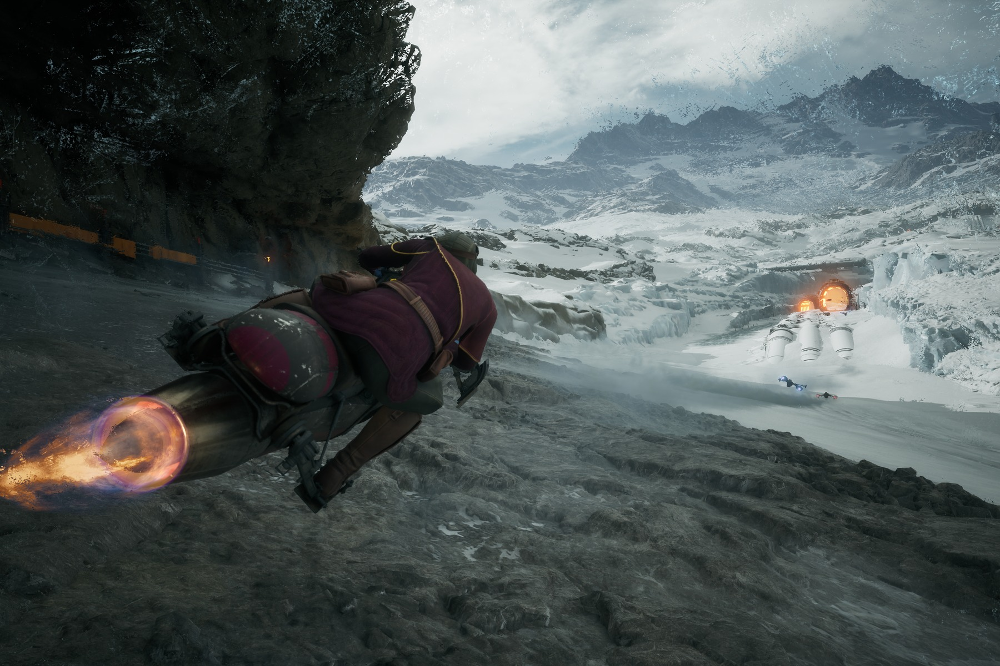

**Verdict: GET IT** · Reviewed on PS5 · ~40 hours (30-35 single-player, 7-8 multiplayer)

---

I'm not a big racing game fan. That's the first thing you should know, because it's the whole review. Sure, I've played Forza and Gran Turismo, but not much and not for long. That's on me. Either way, Galactic Racer might've changed that.

I've played video games my whole life, long enough to get desensitized to the hype other people feel during a match. I don't want to be dramatic and say _Star Wars: Galactic Racer_ made me feel again, because obviously that's not true. But thirty seconds into my first race, I caught myself leaning so far forward I was practically in the TV, knuckles white, genuinely afraid I was going to snap the controller from the tension of almost hitting a wall. My blood was pumping. My heart was pounding. I felt like I was actually racing.

The game released on October 6th. I've already finished it. That's not typically me, regardless of how straightforward this game might seem.

_Galactic Racer_ is the debut from Fuse Games, a UK studio led by veterans of _Burnout_ and _Need for Speed_ at Criterion, published by Secret Mode. That Burnout DNA is everywhere: this is arcade combat racing, fast and physical, where wrecking your rivals is part of the sport. And the campaign is built on a roguelike run structure, which made me groan when I heard it, because I'm tired of the roguelike formula. But here it actually makes sense, for what feels like the first time. Each run is a tour, each race a gamble, and the structure gives the campaign a momentum that a flat playlist of tracks never could. This is a good use of the formula, and I don't say that lightly.

Some of that feeling is mechanical. The vehicles handle beautifully. You can get terrifyingly close to a wall, close enough that your shoulders climb into your ears, and still hold it together. The whole game lives in that risk-versus-safety margin: it rewards you for flirting with disaster and never feels cheap when you misjudge it. And the sound design does the rest of the heavy lifting. Engines screaming as they rev up, the whine of the speeders, all that Star Wars noise baked into your brain from childhood, all of it selling the feeling that you're going impossibly fast. The sound doesn't decorate the speed. It convinces you of it.

<figure>

<figcaption>Screenshot courtesy of Secret Mode/Fuse Games</figcaption>
</figure>

It sustains. That's the thing I keep coming back to. Thirty-plus hours of campaign and scenarios, and it never sagged. I'm bad at finishing games these days. But I was compelled to finish this one. Part of that was Kestar Bool, who has an incredibly punchable face and is a downright asshole, and wanting to beat him absolutely kept me going. But honestly, he was a bonus. The racing was the reason.

And the Skim Speeder. I have to say it: Skim Speeder supremacy. If you know, you know. I still lose almost every time to a Speeder Bike, we're just going to ignore that fact.

The knock, because there's always one: multiplayer gives you no quick way to communicate intent. The racing is physical and aggressive, which is the point, but it's genuinely hard to tell when someone wrecked you on purpose and when they just blew past you and obliterated you by accident. Wrecking is part of the game. People are allowed to play aggressive, and I'm not salty about that. If anything I wish I could apologize: there have been plenty of times I've flown around a corner and painted the opposite wall with my opponent and genuinely felt bad about it. But getting knocked out of first place on the final lap of the final race, on purpose or not, with no way to say "sorry!" or "haha 😈" afterward... I had to set the controller down and walk away for a few minutes. A quick-chat wheel would fix most of it.

So who is this for? Racing fans have obvious reasons to care, and _Star Wars_ fans have obvious reasons. I love _Star Wars_, mainly the lore. I'm a big lore nerd, point me at some source material with a mysterious past. But I wouldn't call myself a superfan by any means. Seen the movies? Sure. Do I know that the story of Darth Plagueis isn't one the Jedi would tell you? Of course I do. Do I know the story of Darth Plagueis the Wise? Coincidentally enough, also yes. (Maybe I should reclassify my fan status.) The point is I'm generally not a racing fan at all. And it got the mix exactly right: perfectly approachable, never dumbed down. If it can convert me, it has a real shot at people outside the usual arcade-racing audience too.

**Verdict: Get it.** Buy it whenever you can. It's worth the money.
