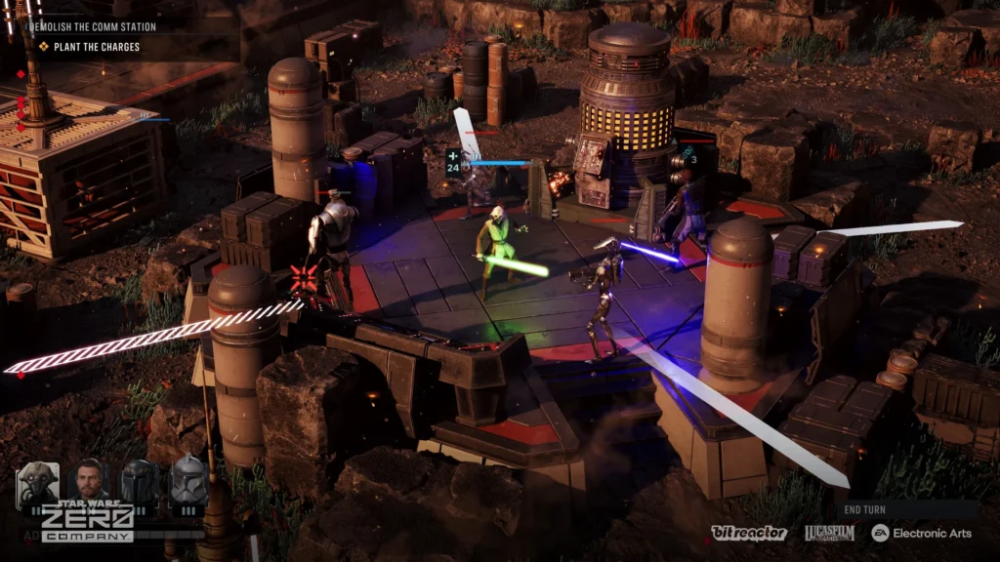

The mission is called Hostage Situation. The name is the whole briefing.

Somewhere on Lothal, someone needs getting out, and the game gives you a turn limit to do something about it. I remember staring at the objective the way you stare at a microwave timer when you're already late. The pressure doesn't make you think faster, exactly. It makes you think narrower. Every option I had a minute ago is still on the table, but now they're sorted by urgency, and the sorting happens almost without me.

That was the feeling I kept having through all of _Star Wars Zero Company_, and it took me most of the campaign to put a name on it. Battle felt fluid and pressing but never overwhelming. I never felt paralyzed, not by inaction, not by too many choices. It felt like I had just enough agency with the right amount of direction and pace. And the longer I played, the more I realized the feeling wasn't an accident. It was the design.

Here's the idea, plainly stated: Zero Company hands you an unusual amount of tactical freedom, then spends the whole game making sure that freedom never goes slack. Timers, uncertainty, enemy threats, strategic consequences. The rope stays taut. And a taut rope is what makes turn-based combat feel like an action movie.

The freedom starts with the turn itself. Every operator gets three action points, spendable on movement, attacks, and abilities in whatever order the moment needs, and you're free to bounce between operators instead of playing them one at a time. Move Hawks into cover. Switch to Trick for a buff. Jump back to Hawks for the shot. Reposition the healer. Fire the shot you set up three switches ago.

<figure>

<figcaption>Star Wars: Zero Company tactical combat. Electronic Arts / Bit Reactor press image. Provenance: official. <a href="https://bespinbulletin.com/new-star-wars-zero-company-gameplay-screenshots-released-2/">Source</a></figcaption>
</figure>

_XCOM_ wrote the genre's grammar: two actions per soldier, move then act, commit and pray. Zero Company breaks the commitment into pieces and lets you rearrange them mid-turn. I called it "very fluid and easy to understand" in my notes, which undersells it. What it actually does is let you adapt on the fly, revising the plan as the battlefield revises itself. A missed shot isn't a ruined turn. It's new information with action points still left to spend.

Cover works the same way. There's a lot of it, varied in integrity, material, and height, and the right choice changes minute to minute as enemies shift and walls come down. Positioning never settles into a solved puzzle. You're always one demolition away from rethinking everything.

But freedom is only interesting when something is pulling against it. Enter the timer.

Zero Company loves a turn limit. Missions with orders like "save this person within 5 turns" show up regularly, and my reaction was always the same: the pressure cranks up the focus and the necessity to act, but it never feels impossible. The timer doesn't delete your options. It recategorizes them. That flanking maneuver you'd love to set up over three turns becomes something you'll do in one turn or not at all, and the decision gets made fast, almost physically. I'll tell you how many extractions ended with me saying "by the skin of my teeth" out loud to an empty room. Enough that it became a ritual.

That's the first meaning of the action-movie feeling: the game plays fast in your hands despite being turn-based. But there's a second meaning, and I want to keep it separate, because it's stranger.

The second meaning is cinematic. It's my head supplying footage the game never shot. Part of it runs on pre-installed urgency: imagining a dropship swooping in to pull my squad off a hot landing zone isn't a stretch, because I've watched that shot in _Star Wars_ movies my whole life. The game doesn't have to sell it.

And there's something about the deliberation-then-action rhythm that turns you into a director. You spend the planning phase running the sequence in your head, shot by shot, and by the time you commit, the movie has already premiered in your skull. The game just screens it.

That's the Trick thing. At one point I caught myself visualizing Trick grabbing a wounded hostage by the collar and dragging them toward the ship while Hawks laid down covering fire. None of that happens literally, not in that cinematic way. But the mechanics, the pacing, the pressure made me direct the scene anyway. The game supplies the situation. I supplied the movie.

Then there's the layer above the battlefield, and this is where the game got its hooks into me deepest.

Between missions, the strategy layer throws crisis decisions at you: pick your penalty. At one point I had to choose between B2 battle droids getting stronger rockets or +2 defense. My first instinct was pure lizard brain. Stronger rockets sounded terrifying. Bigger explosions, more damage, get rid of that one.

Then I actually thought about how I play. I already prioritize B2s the moment they start prepping rockets. It's automatic. The rocket telegraph goes up and those droids become my whole world. So I asked myself which upgrade actually hurts me more, and the answer flipped. Stronger rockets just make me prioritize them harder, which I'm doing anyway. But +2 defense on the thing I'm already shooting at? That blunts my counterplay directly. It makes my actual habit worse.

I picked the defensive upgrade to deny, and the important thing isn't whether that was objectively correct. It's that a menu choice at the war table forced me to interrogate my own tactical habits. The strategy layer reached down into the combat layer and made me a smarter player against myself.

That's consequence with teeth. Not "your choice changes the ending" consequence. Quieter than that. Your choices change you.

Now, I'm not saying freedom is good and more freedom is better. That's the trap version of this argument, and Zero Company knows it, because the game spends plenty of time flirting with the failure modes.

The freedom sometimes goes slack. The game is generous with your mistakes in ways that sand off consequence: no opportunity attacks, so repositioning is freer than the tactics deserve, and grenades are openly asymmetrical in your favor, yours exploding on impact while the enemy's give you a full turn to stroll out of the blast radius. Convenient, yes, and maybe a little too convenient. And the interface withholds things it probably shouldn't, like a turn-order display, while extraction behavior sometimes feels unclear in exactly the moments you're most stressed.

I list these not to dunk on the game but because they're load-bearing for the argument. Pressure is only productive when it's legible. A timer you understand focuses you. A rule you can't see just confuses you. The line between tension and friction is thin, and Zero Company crosses it in both directions. The fact that it mostly stays on the right side is the achievement, not a given.

So here's where I landed. Turn-based games hand you something no action game can: unlimited deliberation time. You can sit on a turn forever, and the game will wait. That's the genre's gift and its problem, because deliberation without cost goes slack. Designers have to find some way to preserve urgency despite the pause. Zero Company finds it by giving you more rope than the genre usually allows, three action points and a squad you can conduct like an orchestra, and then pulling the rope taut with timers, threats, and choices that follow you home from the war table.

Just enough rope. Enough to feel like the plan is yours. Never slack enough to stop feeling the pull.

And when it works, when the timer is down to its last turns and the plan you built piece by piece across four operators comes together or falls apart, it doesn't feel turn-based at all. It feels kinetic. It feels like the movie you've been directing in your head finally got its screening.

By the skin of my teeth, every time.
