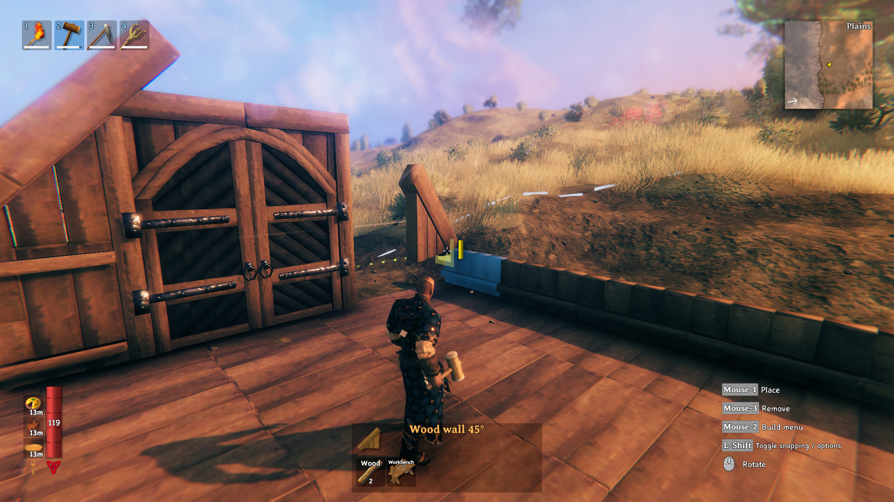
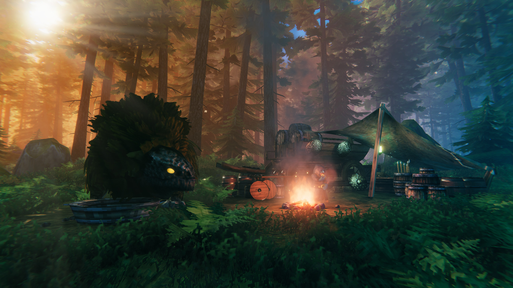

I was three hours into _Valheim_ on PS5 before it occurred to me that I was playing a port at all. Not because the game hides its origins. Because I was busy. I'd spent the first hour learning how far I could wander from my little camp before the forest stopped feeling safe, the second hour turning that camp into something with walls, and the third hour standing on the roof wondering why I'd built the chimney first. The port never came up. There was no moment of translating what the game wanted into what my controller would allow.

That's the whole review, really. Everything after this is just me explaining why that unremarkable fact is remarkable.

<figure>

<figcaption>Building a home in Valheim. Screenshot courtesy of Coffee Stain Publishing. Coffee Stain Publishing / Iron Gate AB. Provenance: official. <a href="https://kotaku.com/games/valheim/gallery/1">Source</a></figcaption>
</figure>

Here's the context. _Valheim_ entered PC Early Access in February 2021. It did not reach PlayStation until September 2026, five and a half years later. In this industry, a five-year gap between PC and console often means a compromised port of an old build, controls with mouse lineage, a version number permanently behind the real game. _Valheim_ on PS5 is none of those things, because it wasn't a belated port. It was a simultaneous launch. PS5, Switch 2, Xbox, PC, all on 1.0, all with full crossplay, day one. Seventeen million people had already bought the thing, and PlayStation players got the finished version on the same morning as everyone else.

This is the second time Coffee Stain has done this. _Satisfactory_ spent five years in PC early access, hit 1.0 in September 2024, and arrived on PS5 and Xbox in November 2025 launching with full 1.1 content parity. Since mid-2026, its patches ship on PC and console simultaneously. Same story: wait, then arrive current.

And here's the part I got wrong in my first draft of this piece. I credited Coffee Stain with the porting itself, like there's a secret port laboratory somewhere in Sweden. There isn't. _Valheim_'s PS5 version was built by a studio called Piktiv, who'd already handled the game's networking backend and helped bring it to PC Game Pass. _Satisfactory_'s console versions were built in collaboration with Fishlabs, a dedicated port studio. The pattern isn't technical wizardry. It's a publishing decision, made twice: hire people who specialize in this, and don't ship until the console version is the real version. The wait was the strategy.

The two ports aren't identical, by the way, and I don't want to oversell the symmetry. _Valheim_ launched with full crossplay across every platform. _Satisfactory_'s consoles share their own multiplayer pool, separate from PC. Parity of version, not of every feature. The point stands, but it's worth saying plainly.

The alternative is everywhere. _Stellaris_ on console has spent much of its life a year or more behind the PC version on expansions. Console players learn the patch notes like dispatches from the future. The bad ports all rhyme: controls that never quite divorce the mouse, interfaces designed for a monitor and squeezed onto a television, versions that lag behind. None of it makes a game unplayable. All of it reminds you, every time you sit down, which version you got.

You could call this a low bar. A port should just work; congratulating one for working is like congratulating a bridge for not collapsing. Fair. But I've crossed enough collapsing bridges to notice the solid ones, and the number of PC-first games that arrive on console feeling like memos from the PC version is exactly why the exceptions register.

Which is why the highest praise I can give the _Valheim_ port is that I keep forgetting it's a port. "Better late than never" is a hollow promise if late also means compromised, outdated, or treated as an afterthought. When the transition works, the delay becomes trivia, part of the game's history, instead of a tax you pay every session. I don't convert what _Valheim_ wants me to do into what my controller permits. I just play.

And the game was worth the wait, which is the other half of it. Why didn't five years date it? Because _Valheim_ never makes me feel behind for spending an hour on my house instead of chasing the next objective. The loop is simple: explore a little further than feels safe, bring back what you find, make home slightly more home, repeat. Exploration earns better gear. Better gear earns further exploration. Everything you carry back gives you another reason to care about the small patch of world you've claimed. Nobody's timing you. A session where I discover a new resource and a session where I build a better fence are both progress. That pace is why five years didn't date it. There's no trend here to age out of, no presentation trick with a shelf life. Walk out, survive the walk back, make home better. Still good.

<figure>

<figcaption>A breather at camp in Valheim. Screenshot courtesy of Coffee Stain Publishing. Coffee Stain Publishing / Iron Gate AB. Provenance: official. <a href="https://kotaku.com/games/valheim/gallery/1">Source</a></figcaption>
</figure>

So no, I don't need every PC game day one on PlayStation. Simultaneous releases are nice when they happen. But I'd rather wait five years for a version that feels like the real game than get one in two that reminds me I'm a second-class citizen with a controller. One good port could be luck: the right team, the right circumstances. Twice starts to look like a policy. Coffee Stain's policy, as near as I can tell: arrive late, arrive whole, and let the port become the least interesting thing about the game.

It worked. I stopped thinking about the port entirely, and I had a crooked house to finish.
