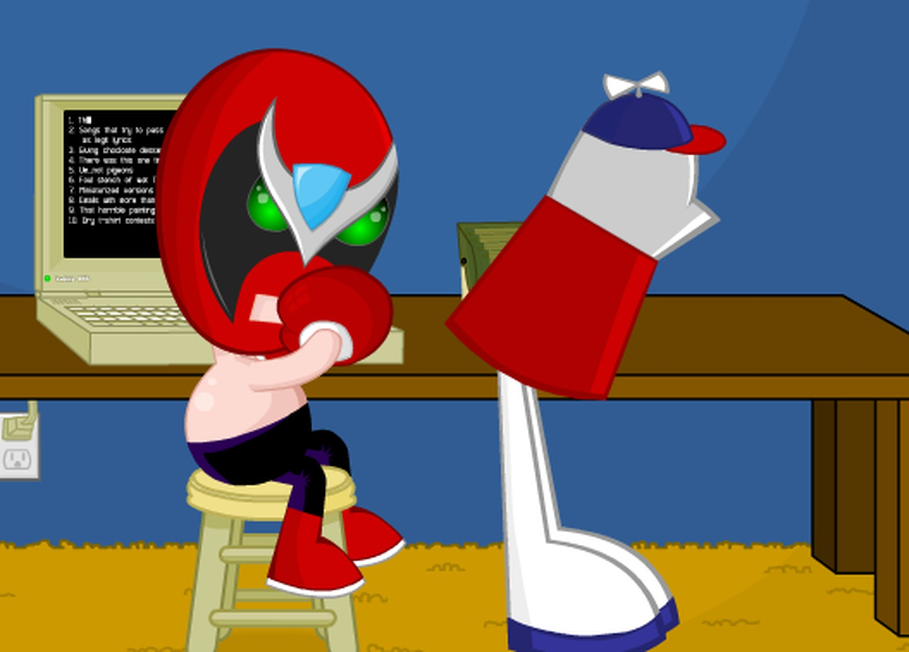
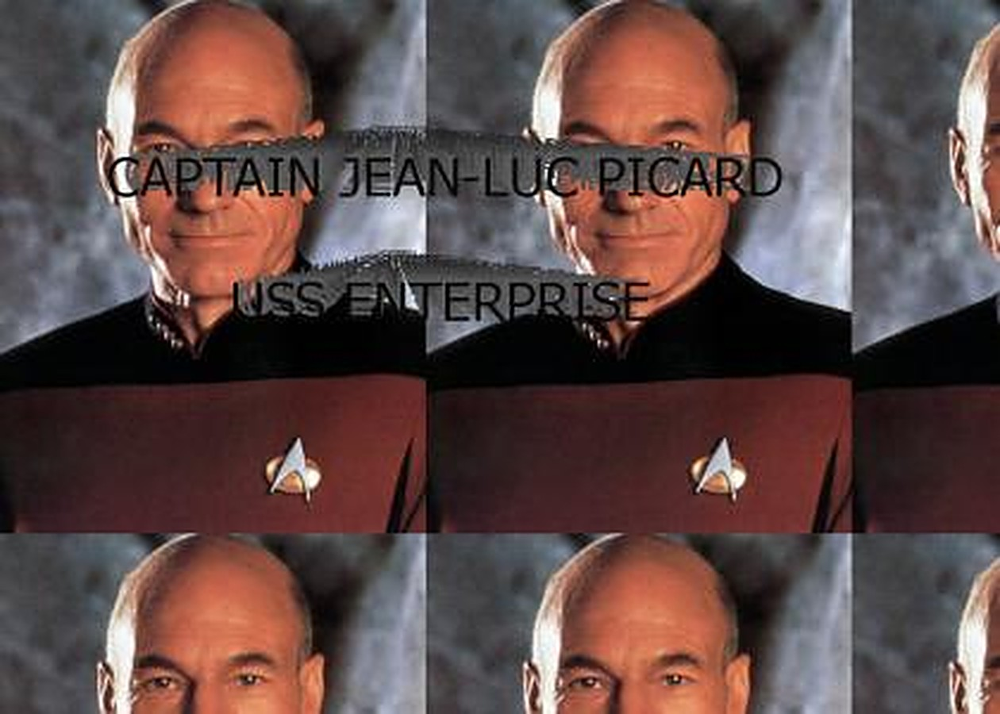

I still ask, out loud, where my hat is at. I am in my thirties. Usually nobody around me knows what I am quoting, and about half the time I am actually looking for my hat. The line is from Homestar Runner, a Flash cartoon site I watched on the family computer, first a wheezing eMachines and then an HP desktop, and it has outlived the computer, the software it ran on, and the era that produced it. That is where the old internet stored its jokes. Not on a platform. In people.

Homestar Runner ran on an economy the modern internet would not recognize. [No ads, ever.](http://hrwiki.org/wiki/UMFM_Interview_-_20_May_2003_(censored)) Two brothers, the Brothers Chaps, made the cartoons and sold merchandise to pay for the site. They had knocked on television's door at the very start and been turned away, and when television came calling later, they were not interested anymore. There was no feed to find it in and nothing to optimize it for. You found out because somebody told you, or because you were already refreshing the page waiting for a new Strong Bad Email, and then you went to school and quoted it at other people who had also been refreshing the page. The quoting was the distribution network. And the quotes were built to be quoted: nothing fancy, nothing fancy, smooth and clean like gasoline, nonsense with the rhythm of a proverb, engineered by accident to live in a teenager's mouth for twenty years.

<!-- Image provenance: Copyrighted editorial artifact. Strong Bad Email frame from Homestar Runner; sourced via the Homestar Runner Wiki mirror. Copyright The Brothers Chaps. Editorial criticism/commentary; no license asserted; not public domain. -->
<figure>

<figcaption>Strong Bad Email, Homestar Runner. © The Brothers Chaps.</figcaption>
</figure>

If Homestar was the old internet at its most crafted, YTMND was the old internet at its purest. A YTMND page was three things: a tiled background image, enormous text zooming at your face, and a sound file on a loop. That was the entire technology, and out of it came the Picard Song, a photograph of Captain Picard under a remix that chants his name and rank until it turns into a kind of hymn. It came early, in the site's first month in 2004, and it spread the way everything spread then, through forum posts and blog links, person to person. Out of the same three ingredients came Darth Vader screaming NOOOO over a tiled still, and Eminem with spaghetti drawn onto his arms in MS Paint because of one line in "Lose Yourself." A YTMND was not performing for a feed. The site had ratings and comments and user pages, like anywhere else, but the joke was not there to grow an account, and what fame there was stuck to the page itself. The page sat at its address, unchanged, for years, and if you wanted somebody to see it you sent them the link like passing a note. It was a destination. You went to the joke, and the joke could take a full minute of looping Picard to land, because nobody was scrolling past it. It was incomprehensible to anyone outside the joke and it did not care, because being legible to strangers was not a thing a joke had to be.

<!-- Image provenance: Copyrighted editorial artifact. Actual foreground image asset from the Picard Song YTMND page, submitted April 25, 2004; asset sourced from YTMND CDN. Patrick Stewart as Captain Jean-Luc Picard; underlying Star Trek: The Next Generation publicity photograph, Paramount/CBS rights. Associated page music: The Picard Song by DarkMateria (not embedded). Editorial criticism/commentary; no license asserted; not public domain. -->
<figure>

<figcaption>The Picard Song page (YTMND, 2004). Image: Star Trek: The Next Generation, Paramount.</figcaption>
</figure>

Newgrounds was the deep end of the same pool. Anybody could upload a Flash cartoon or a game, and everybody did, and the quality swung wildly from genuinely brilliant to unwatchable, sometimes inside the same submission. The unevenness was not a flaw in the system. It was the system: a folk archive with the doors left open, where the audience and the creators were the same people wearing different hats on different days. It had rankings and a front page, so it was never free of scorekeeping, but the prize on offer was standing in that room. A front page cartoon made you famous on Newgrounds, among the people who also made things, and the fame mostly stayed there: it belonged to the room, not to a follower count attached to a personal brand you could carry from site to site.

On the forums, GameFAQs and TeamXbox, every post I made arrived with furniture. Under my name sat my signature, and my signature, because I was a teenager and therefore legally required to be unbearable, was Nietzsche: "Battle not with monsters, lest ye become a monster, and if you gaze into the abyss, the abyss gazes also into you." Under that, my Xbox gamertag: Captian Psycho. Captian. Spelled wrong, permanently, directly beneath a quote about the abyss, attached to every post I ever wrote about video games. That was the old internet's deal with identity. It persisted. Your profundity and your typo had the same shelf life, which was forever, and both of them were yours. The gamertag eventually got replaced. The name at the top of this website is the one that replaced it.

The first time I felt the ground move was on Facebook. For a while, the funniest thing on Facebook was liking things. Not posts. Pages, with joke names, sentences you could pin to yourself. You would like a page called something like "doing the thing you shouldn't do," and your profile would announce it to the world: Zach liked doing the thing you shouldn't do. The like was the joke. You were the punchline and the audience in the same gesture. Then, over the following years, a quiet thing happened to those pages. They got sold, or they turned into something else while nobody was looking: a content farm, a storefront, a brand. [There turned out to be a market for pages with big like counts](https://www.adweek.com/performance-marketing/how-much-is-a-facebook-fan-worth-to-you/), and the audience the joke had gathered was the asset all along. We thought we had been participating in something. We had been building inventory.

Brands arrived on social media in the same years. The first ones I remember were strange and funny, because nobody knew the rules yet and whoever was running the accounts was making it up. Then everybody learned the rules, and it became a department, and the internet grew an antibody, two words long: silence, brand. The meme changed shape to survive in the new house. We used to send each other pictures with words on them. Now we send each other videos: Shorts, Reels, TikToks. The remix unit moved from the image to the sound, and the joke became a performance. People act memes out now, faces to camera. The format asks for it, and the feed is built to favor a moving face over a screenshot of text. A modern joke gets one second to explain itself, muted, vertical, on a screen it shares with everything else ever made.

And yet the folk process never actually stopped. Consider the letter E. In 2015 a stranger photoshopped Markiplier's face onto Lord Farquaad. In 2018 another stranger ran the picture through a deep fryer and captioned it with the single letter E, and a third stranger pasted the result onto Mark Zuckerberg testifying before Congress. [No one of them made that meme.](https://knowyourmeme.com/editorials/guides/what-is-lord-marquaad-e-and-why-is-markipliers-face-on-lord-farquaad-an-inscrutable-relic-from-meme-history-explained) It accreted, one anonymous improvement at a time, exactly the way the old jokes did. And it is funny for a reason a 2003 demotivational poster could never manage: it assumes you have been here for twenty years. The poster explained itself, image, caption, done. E explains nothing and lands instantly, if you speak the language, because the language is cumulative. It is twenty years of other people's nonsense, stacked, until one letter can carry the whole pile. Richard Dawkins coined the word meme for an idea that copies itself from mind to mind. The platforms changed who profits from the copying. They did not change the copying.

Homestar Runner's site survives today running on an emulator, a museum piece that still works, because Flash was switched off at the end of 2020 and the cartoons refused to be switched off with it. They were never really stored there anyway. They were stored in the people who quoted them, which is why the jokes survived their platform, their software, and their decade. The feed forgets everything by Friday. I still know where my hat is at.

---

Sources:
- YTMND history and format, the Picard Song page (April 2004, DarkMateria): Wikipedia, "YTMND"; Know Your Meme, "YTMND."
- Homestar Runner economics (no advertising, T-shirt and merchandise sales, word of mouth): Mike Chapman, UMFM interview, May 20, 2003, transcript via the Homestar Runner Wiki. Launch (2000, Brothers Chaps), the 2000 Cartoon Network pitch and later disinterest in television, and survival via the Ruffle emulator: Wikipedia and the Homestar Runner Wiki, "Homestar Runner."
- The market for Facebook Pages (pages bought for their ready-made audiences and priced per fan; in 2009 OraBrush, a tongue-cleaner company, outbid Hershey's for the Kisses page and its 1.1 million fans): Adweek, "How Much is a Facebook Fan Worth to You?" June 1, 2009.
- Lord Marquaad / "E" (2015 Farquaad edit, 2018 deep-fried "E," Zuckerberg composite): Know Your Meme, "What Is 'Lord Marquaad E'."
