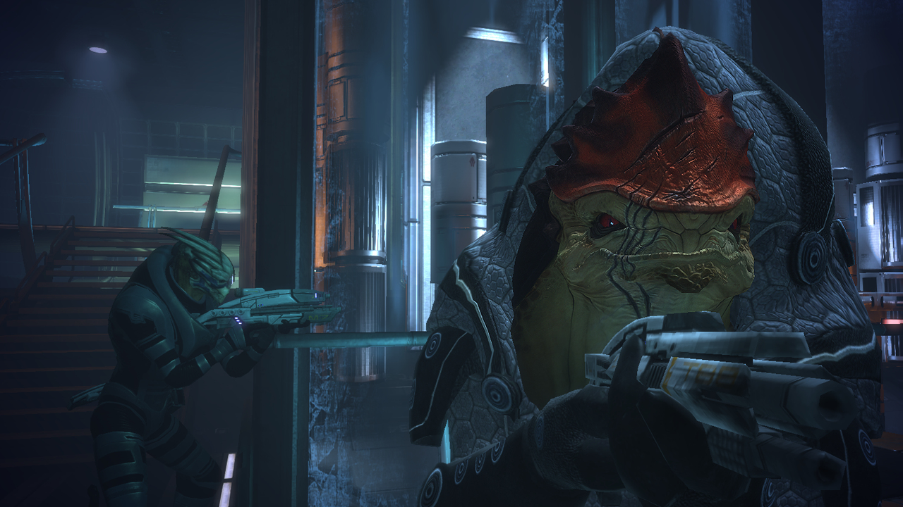
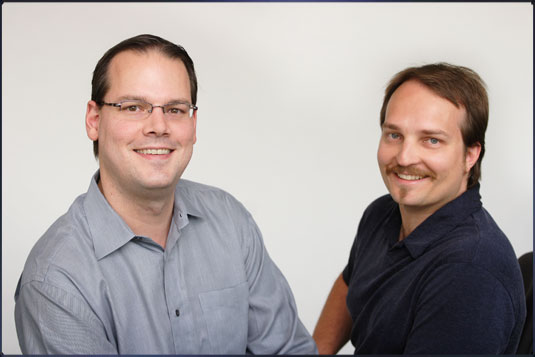

<!-- Hero provenance: Copyright BioWare / Electronic Arts. Copyrighted editorial-use artifact; no license asserted. Source page: https://screenrant.com/mass-effect-legendary-edition-collect-model-ships/ -->

I played Knights of the Old Republic first, then Jade Empire, then Dragon Age: Origins, and then Mass Effect. But Mass Effect is the one. I was just getting into Star Trek at the time, and the thing that drew me in was the ship. The Normandy. I had huge grand ideas in my head that it was going to be customizable, that it was going to be my own Enterprise, and in a way it was. My imagination ran wild, and that is the game itself doing that, not me doing the game's work for it. BioWare handed me a ship and a crew and got out of the way of my head.

The memories that stuck are not the big set pieces. They are lines and rooms. The beginning on Eden Prime. Saren, in the recording Shepard shows the Council, telling the geth: "Set the charges. Destroy the entire colony. Leave no evidence that we were here." That line lives rent free. Virmire, the mission where you find out what the Reapers actually are, and the enemy stops being a villain and becomes a cycle. The suicide mission, where the whole game becomes a checklist of whether you cared enough about your people to keep them alive. Mordin Solus dying on a tower on Tuchanka, singing as he disperses the cure for the genophage he helped modify, because someone else might have gotten it wrong. And the crew. Garrus is and will always be number one, and I ran Garrus and Wrex together almost every single time I could, across all the games. That was the original crew, as far as I am concerned. BioWare's real product was never a combat system or a graphics engine. It was people you would bring everywhere, every time, and a ship that felt like yours because you had decided it was.

<!-- Image provenance: editorial. Copyright BioWare / Electronic Arts. Copyrighted editorial-use artifact; no license asserted. Source URL: https://www.gamegrin.com/directory/game/mass-effect/images Supplied via GameGrin Mass Effect screenshot set; supplied CDN host: cdn.gamegrin.com. -->
<figure>

<figcaption>Wrex and Garrus (Mass Effect). Image: BioWare / Electronic Arts.</figcaption>
</figure>

I did not know who made any of this when I was playing it. I was ten or twelve and I had not learned to associate developers with games yet. I had played KOTOR and Jade Empire and probably Origins by the time I saw the interview. Tommy Tallarico was interviewing them, probably on Judgment Day, and what stuck with me was learning that one of them was an actual doctor. The truth is better than my memory: all three of them were. Ray Muzyka, Greg Zeschuk, and Augustine Yip were all medical doctors. Muzyka and Zeschuk had been writing medical education software for the University of Alberta when Yip joined their partnership, and in 1995 they founded a game studio in Zeschuk's basement. The studio was literally run by doctors, and I found that out on television before I knew what a developer was. A studio with faces. That was normal then. You could know the names of the people who made your favorite thing, and the names meant something.

<!-- Image provenance: editorial. Copyright BioWare / Electronic Arts. Copyrighted editorial-use artifact; no license asserted. Source URL: https://cdn-www.swtor.com/sites/all/files/en/cb/ray_greg_535x357.jpg Source page: https://www.swtor.com/blog/ray-and-greg-thank-you-playing -->
<figure>

<figcaption>Ray Muzyka and Greg Zeschuk, BioWare co-founders. Photo: BioWare / Electronic Arts.</figcaption>
</figure>

I kept showing up for BioWare long after the golden run. That matters, because the easy version of this essay is that I quit in 2012 and everything after was betrayal, and that is not what happened. Andromeda had a great premise, but it was not Mass Effect. I loved Anthem and I was sad when it shut down, but it was a shell of a game. And my BioWare ended, technically, at Veilguard. I played it maybe five hours. It just was not it, and I want to be clear about this because the internet will not be: it was not the "woke" argument, it was not that. It just was not Dragon Age, in my honest opinion. It had been too long since Inquisition, and BioWare had changed so much in the meantime that the name on the box and the thing in the box had come apart. The people left in stages. Muzyka and Zeschuk left in 2012. The veterans left across the decade that followed, in layoffs and departures and quiet exits. By the time EA announced the closure on October 21, there were about fifty people left at BioWare, with a small team working on a Mass Effect game that never got an officially announced title, and the studio they worked for had been leaving the building, person by person, for years. The closure closed a name and an office. The dispersal happened long before.

That is why the leaked trailer hit the way it did. A day after the announcement, a two-minute internal video surfaced, never meant to be seen: in-engine footage, pre-production assets, a new protagonist in a trench coat, an asari in a bar, an older Liara returning at the end, a title card reading Mass Effect: Universe. It was confirmed real, and it changed nothing. The game is still cancelled. The trailer is a ghost, and ghosts are useful for exactly one thing, which is showing you the shape of what is missing. What was missing was a Mass Effect about a spy, centuries after the trilogy, built around the one thing BioWare always did better than anyone: letting your choices be the story.

So here is the part that is not the elegy. The petition asks EA to fund Mass Effect or license it to someone else, and more than 260,000 people have signed it, and EA has said nothing. My dream is that CD Projekt Red gets it, and I will not pretend that is not a wish. But the wish is not the argument. The argument is what already happened in public the week BioWare died. CD Projekt's joint CEO posted that BioWare was a massive part of CDPR history: they had localized Baldur's Gate in Poland, and later BioWare lent them the Aurora Engine for the first Witcher, shared their knowledge, and gave them a spot at the E3 booth, where an early build of the Witcher was shown behind a curtain in 2004. The director of the cancelled Mass Effect replied to him: "Thank you, Michał. We have always been your fans. And always will be." The studio that lent CD Projekt its engine and a corner of its E3 booth got thanked in public the week it died, and the people who were making the next Mass Effect thanked them back. That is the inheritance, already in motion, whether or not EA ever licenses anything. The template did not die with the studio. It lives in the studios BioWare helped, directly or by example, and in Larian, and in CD Projekt, and in every game that gives you a crew and a hub and a choice that matters. Ideally, it just would not die. It would be given to someone who would respect the IP, the dream, and the vision of the original devs and creators. But even if it is not, the handing over already happened, and it happened years ago.

BioWare closed. The Normandy did not. It was never really theirs to close. It was mine, and it was yours, and it was everyone who ever decided that a ship and a crew were enough to build a galaxy out of. That is what a studio is, when it works: not an office in Edmonton, but a set of people who hand you something and trust your imagination to finish it. The people are gone. The handing over is not.
